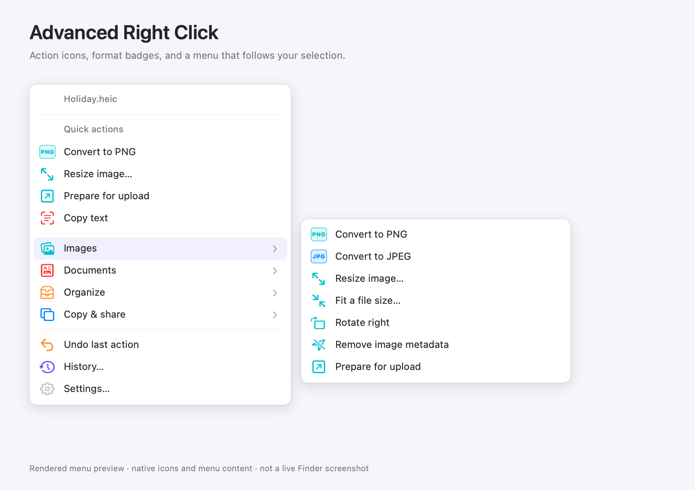

# Advanced Right Click

A native macOS utility that adds context-aware file tools to Finder’s right-click menu. No Dock icon, no dashboard, and no menu-bar icon by default. A configuration window controls the menu, background behavior, and recovery history.

Built in the same style as [Meeting Mode](https://github.com/berkegokmen1/meeting-mode): native Swift, an AppKit lifecycle, no third-party runtime dependencies, straightforward scripts, and a standalone `.app` plus `.pkg` installer. Settings and small action panels use SwiftUI. Inspired by [Tangerine’s](https://tangerineformac.com/) local processing and unobtrusive workflow; this app uses Finder menus rather than its drag gesture.

## License

[Advanced Right Click Noncommercial License 1.0](LICENSE). Noncommercial use, modification and free redistribution are permitted. Commercial use is prohibited, including selling the app, commercial redistribution, paid-work use, internal business use, and inclusion in commercial products or services. There are no organization exceptions. Keep the license and copyright notice with redistributed copies. This is source-available software, not an OSI-approved open-source project.

## Install and use

1. Download the installer or app ZIP from [GitHub Releases](https://github.com/berkegokmen1/advanced-right-click/releases/latest). The installer places the app in `/Applications`; alternatively, unzip and copy the `.app` there. Builds are currently for Apple Silicon and are ad-hoc signed, with an unsigned installer; they are not notarized. Local builds produce the same files under `build/`.
2. Open **Advanced Right Click** once. Its first launch shows configuration.
3. In **System Settings → General → Login Items & Extensions → Finder**, enable **Advanced Right Click**. Depending on macOS, Finder extensions may be listed under Extensions instead.
4. Right-click a file or folder → **Advanced Right Click**. The menu only offers actions compatible with the selected items.
5. Close configuration. The utility continues quietly. Reopen configuration using **Advanced Right Click → Settings…** in Finder, or reopen the running app from Applications.

For a HEIC photo, **Convert to PNG** creates `photo.png` beside the original and removes `photo.heic` from that folder only after keeping a private backup. **Undo last Advanced Right Click action** restores the original bytes and removes the converted output.

If Finder has not discovered the extension, **right-click → Services → Advanced Right Click** opens a native action menu as a fallback. The app needs to be discoverable by Launch Services; install it in Applications and open it once. The installed Finder extension has been verified with single-item, multi-item and folder-background selections. The Services fallback still needs separate end-to-end verification.

## Included actions

There are 38 actions, with batch support where applicable:

| Selection | Actions |
| --- | --- |
| Images | PNG, JPEG and HEIC conversion; resize; target file size; clockwise rotation; metadata stripping; prepare for upload; contact sheet |
| Images / PDFs | Combine into PDF; on-device OCR / text extraction; detect links; searchable PDF |
| PDFs | Split all pages; extract a page range; rotate; compress |
| Video / audio | MP4 conversion; M4A extraction/conversion; mute video; trim video or audio; short GIF |
| Files / folders | Batch rename with preview; ZIP together or individually; safely extract ZIP; compare two files |
| Any selection | Copy full path, filename or Markdown link |
| Small text files | Copy UTF-8 file contents |
| A folder | Largest-file report; identical-duplicate report; organize loose files by extension or modification month; text/Markdown/checklist templates; paste clipboard text/image as a file; open Terminal |

**Prepare for upload** applies a 1600px maximum dimension, JPEG encoding, and removes embedded GPS, EXIF and IPTC metadata. Images keep their aspect ratio and are not upscaled. JPEG flattens transparency onto white.

Every action has a colored native icon, and conversions have distinct PNG, JPG, HEIC, MP4, M4A and GIF badges. Categories have their own icons and colors. Favorite actions appear under Quick actions at the top of the submenu (up to four applicable favorites). Other actions are grouped by category. Finder and the Services fallback use the same menu layout. Disable unwanted actions in **Settings → Menu**. The background host publishes the menu masks through macOS notification state; the extension falls back to default choices if unavailable. Preference changes use the same shared menu builder; live preference propagation still needs separate verification.

Simple actions run without opening configuration. Actions requiring parameters open a compact 380px panel with only the necessary controls. Trim and GIF panels include video playback (or an audio waveform), a visual timeline with adjustable start/end handles, and selected-segment playback. PDF actions show page thumbnails and a page preview; extraction uses visual start/end page selection. The panel fits its content as previews load; folder reports and comparison actions display temporary result windows. Completion messages are optional. The optional menu-bar icon and Open at login are off by default.

## Undo and recovery

- Each mutating batch is one history entry. Originals are copied before replacement; moves preserve the original location in the journal.
- In-place conversions and explicit renames refuse destination collisions. A conflicting later member prevents the entire batch from starting. New derived outputs such as PDFs, archives and extraction folders use an unused numbered name.
- Cancellation during a commit attempts to restore all completed members. Interrupted operations remain visible in History and must be recovered before more changes.
- SHA-256 content checks refuse undo if an output has been edited, replaced, moved or removed. Whole-batch checks happen before undo starts. File contents and directory names are checked; external attribute-only edits are not detected.
- History and backups survive app restarts. Backups are not automatically purged. Restore an entry before removing its record.
- The store uses an exclusive process lock to reject a second app copy using the same history directory.

Storage: `~/Library/Application Support/Advanced Right Click/History/`.

### Finder ⌘Z

**Settings → General → Allow immediate ⌘Z in Finder** is opt-in and requires Accessibility permission. The event bridge is armed for 30 seconds after a completed operation only while Finder is active. It consumes ⌘Z only if that is the next interaction. Another click, key, scroll, app switch, or new operation disarms it. It does not add operations to Finder’s private native undo stack and does not implement Finder redo. Check permissions again with **Retry** after granting access.

Undo is also available directly in the right-click submenu and in History. Ordinary text editing keeps its own undo behavior. The optional Finder keyboard bridge is implemented but has not been validated with granted Accessibility access.

## Build and test

Requires macOS 13+, Apple Silicon (default build), and Xcode Command Line Tools. Full Xcode is not required. An Intel build can be requested with `ARCH=x86_64`, but has not been tested.

```sh
./scripts/build.sh
./scripts/test.sh
ARC_TEST_VISION=1 ./scripts/test.sh
```

The build produces:

```text
build/release/Advanced Right Click.app
build/AdvancedRightClick-0.1.4.pkg
```

The app and embedded Finder extension are ad-hoc signed; the installer is unsigned and neither is notarized. Use Developer ID signing, proper extension provisioning as required by your distribution, installer signing, and notarization before distributing broadly. `SIGNING_IDENTITY` lets the build script use an installed code-signing identity; it does not perform provisioning or notarization.

HEIC, Vision and media tests must run with access to macOS hardware/daemon services. A restrictive execution sandbox can prevent the HEIC encoder from initializing even when the same test passes outside it. The final suite passed 34 integration checks covering all 38 actions, plus 211 menu and Finder-handoff assertions. Native Finder conversion, batch resize, template creation and Undo were also verified. All tests use generated workspace fixtures; no personal files are needed. Set `ARC_DATA_DIR` to use alternate recovery storage for development and `ARC_BACKGROUND=1` to suppress the first-run settings window.

## Project layout

```text
Sources/
  Actions.swift          Shared action catalog, options and request validation
  MenuPreferences.swift  Small preference bridge to the Finder process
  ActionMenu.swift       Shared grouped menus, colored icons and format badges
  History.swift          Backups, content fingerprints, commit and recovery
  Operations.swift       Image, PDF, OCR, media and folder processing
  OutputNames.swift      Unused names for newly generated outputs
  Previews.swift         Compact media and PDF previews
  PreviewRange.swift     Timecodes and exportable range bounds
  Archive.swift          ZIP validation and system archive tools
  FinderUndo.swift       Opt-in, narrowly scoped Finder keyboard bridge
  AppModel.swift         Serial operation execution and preferences
  Views.swift            Configuration, small option panels and comparison
  main.swift             AppKit lifecycle, Services and optional menu-bar item
FinderExtension/         Sandboxed Finder Sync contextual menu
Config/                  Bundle metadata and extension entitlement
Tests/                   Generated-file integration and recovery checks
scripts/                 Build, icon generation and test runner
docs/                    Validation record and manual checks
Assets/                  Reserved for bundled assets
```

## Current limits

- Finder Sync is Apple’s synchronization-oriented extension point. It supports contextual menus, but Apple does not position it as a general Finder customization API. Cloud-provider locations and other Finder extensions can affect menu availability. The installed extension has been activated and tested on this Mac; cloud-provider locations remain unverified.
- All processing uses Apple frameworks plus the macOS `zip` and `unzip` tools. There is no FFmpeg or Office runtime. WebP/AVIF output, MP3 encoding, arbitrary Office/spreadsheet conversion, and custom user-authored recipe chains are not included.
- Single-frame raster images are supported. Animated/multi-image sources are refused rather than silently dropping frames. HDR gain maps, depth/auxiliary image data, and every proprietary metadata field are not preserved in converted outputs. Originals remain recoverable.
- PDF compression rasterizes pages, losing live text, annotations, forms and links. The options panel explains this before applying it. It refuses a result larger than the original. Searchable PDFs rasterize visible pages and add an invisible OCR layer; they do not preserve PDF interactivity.
- Media outputs are created alongside the source. Trim exports video or audio; GIFs are limited to 15 seconds at 8 fps and 480px.
- ZIP extraction supports ordinary, unencrypted, single-volume ZIPs with UTF-8-compatible names, no links, fewer than 10,000 entries, and at most 2 GB declared expansion. ZIP64 and ambiguous/traversal paths are rejected.
- Processing selected symbolic links is refused; copying their paths or names remains available. Case-only batch renames and cross-volume moves are not supported. Folder scans skip hidden files, package contents and undownloaded iCloud items; scans stop at 50,000 entries. Comparison is side-by-side, without highlighted diffs.
- File transformations should run on files that are not actively being edited elsewhere. Content checks minimize conflicts but are not a lock on every other process.

See [validation notes](docs/VALIDATION.md) for verified results and remaining live-system checks.

## Menu preview



Rendered from the shared native menu data and icons, not a live Finder screenshot.
